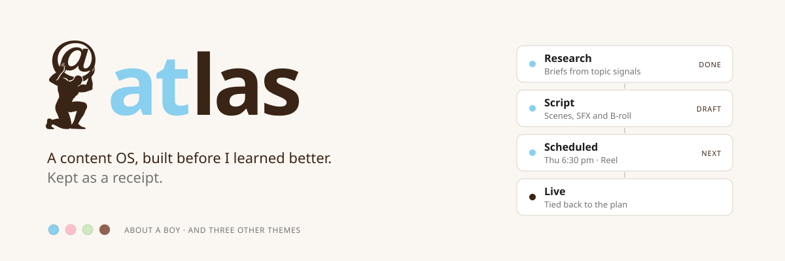

<div align="center">
  
</div>

<p align="center">
  
  
  
  
</p>

<br/>

> **Atlas Content OS** was a SaaS I built to plan content like a pipeline — research, brainstorm, schedule, analyse. A dashboard for people who treat posting online like a repeatable process instead of a vibe.
>
> It didn't stick. Kept in the repo as a reminder.

<br/>

## What it tried to be

A single app for content creators who were tired of seven tabs. Atlas had:

- **Research** — pull topic signals, organise them into briefs.
- **Brainstorm** — prompt-driven ideation that fed into the content table.
- **Content** — a pipeline view of every piece, from idea → draft → scheduled → live.
- **Analytics** — a dashboard of what actually worked, connected back to what was planned.
- **Onboarding + Auth** — full Supabase-backed multi-user setup.

It was built and it worked. It just didn't find a person who needed it enough to pay.

<br/>

## Why it's here

I'm keeping it public for one reason: **it's a reminder**.

> *You don't read about the ocean to learn how to swim.*

Atlas was, in its own way, me trying to **read about content creation** — planning the pipeline, structuring the workflow, systemising the output. It turns out you can't build a content habit by building a content OS. You get good at making content by **making content**, not by modelling what making content should look like.

The lesson: **plans are downstream of reps.** Throw yourself in, feel what the work is actually like, and then — if you still need a tool — build it for the shape of the problem you actually hit, not the shape you imagined.

<br/>

## Stack (for the curious)

| Layer | Tech |
|---|---|
| Framework | **Next.js** · App Router · TypeScript |
| UI | **shadcn/ui** · Radix · Tailwind |
| Database / Auth | **Supabase** |
| Charts | **Recharts** |
| Forms | React Hook Form · Zod |
| Initial scaffold | [v0.app](https://v0.app) — extended by hand |

The design system is documented in [`docs/COLOR_SCHEME.md`](./docs/COLOR_SCHEME.md). The theme is called **"about a boy"** — warm cream paper, dark brown ink, a small baby-blue accent. That part, I'm still proud of.

<br/>

## Running locally

```bash
pnpm install

# Supabase project required
cp .env.local.example .env.local

# Required env vars
#   NEXT_PUBLIC_SUPABASE_URL
#   NEXT_PUBLIC_SUPABASE_ANON_KEY
#   SUPABASE_SERVICE_ROLE_KEY

pnpm dev
```

Schema lives in the Supabase project — `content`, `briefs`, `research_topics`, `users`. Not ported here as standalone migrations; if you want the full setup, get in touch.

<br/>

## Project layout

```
atlas/
├── app/
│   ├── page.tsx          Landing — marketing + demo
│   ├── auth/             Sign-in, sign-up, callbacks
│   ├── onboarding/       First-run flow
│   ├── dashboard/        Post-login shell
│   ├── research/         Topic discovery
│   ├── brainstorm/       Prompt-driven ideation
│   ├── content/          Pipeline view
│   ├── analytics/        Performance dashboards
│   └── profile/
├── components/           shadcn-based UI library
├── docs/
│   └── COLOR_SCHEME.md   "about a boy" theme — kept
└── lib/
```

<br/>

## License

No license granted. Source is visible as a portfolio artefact — **all rights reserved**. Keep the lesson, not the code.

<br/>

---

<p align="center">
  <sub>Built by <a href="https://github.com/KezLahd">Kieran Jackson</a> · Chapter zero · 2026 · Another <a href="https://instagram.com/kieranjxn">Kez Curation ↗</a></sub>
</p>
